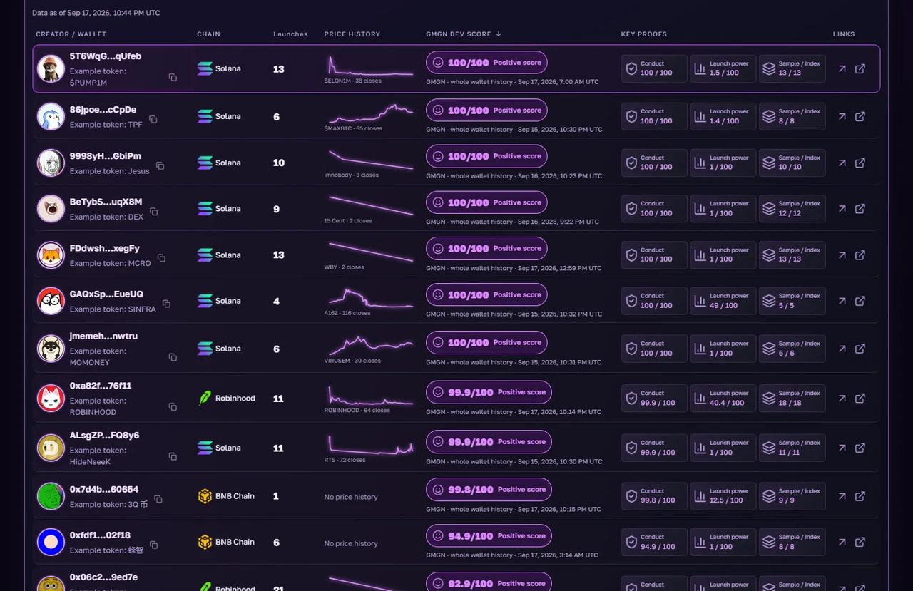
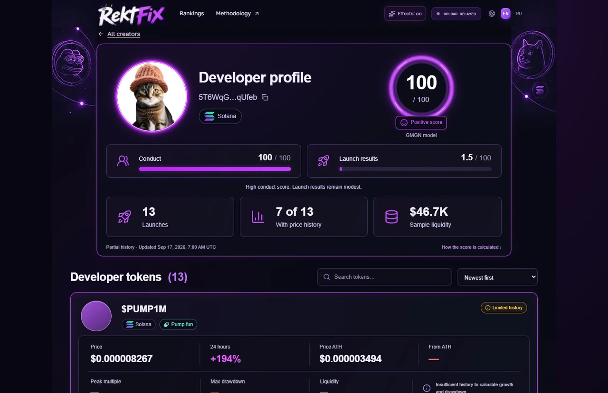

# RektFix - аналитика создателей токенов

**Автор проекта:** [Евгений Толмачев](https://github.com/EvgenyET) · [Страница проекта в портфолио](https://evgeny-dev.pro/project.html?id=RektFix)

Веб-сервис для изучения создателей токенов Solana и EVM-сетей: поиск, профили, история запусков, рыночные данные и отчёты внешних источников.

## Мой вклад

Спроектировал каталог и профиль создателя токенов так, чтобы из списка можно было перейти к истории запусков конкретного кошелька. Сбор данных вынес в отдельный процесс. В профиле разделил собственные расчёты по истории цен и оценку GMGN, для которой показываю дату и доступность отчёта.

## Интерфейс

**Каталог создателей токенов**

**Профиль создателя с показателями и историей запусков**

## Как это работает

RektFix собирает сведения о токенах и связанных с ними кошельках в общий исследовательский интерфейс. Пользователь фильтрует выборку по сети, ищет адрес или название, открывает профиль создателя и сопоставляет запуски, ценовую историю и отчёты источников. Сборщик обновляет данные отдельно от сайта, сохраняет прогресс и синхронизирует подтверждённые пакеты с серверной базой. В текущей версии GMGN Score и его покрытие показываются отдельно от собственных расчётов по ценовой истории. Неизвестные и устаревшие данные остаются явно обозначенными.

## Возможности

- Поиск по адресу создателя, адресу токена, названию и тикеру, фильтры Solana, BNB Chain и Robinhood Chain.
- Профиль создателя с постоянной ссылкой, списком токенов, историей цен и переходами к источникам.
- Отображение GMGN Score с версией модели, датой и ограничениями покрытия отчёта.
- Сбор рыночных данных и истории запусков через внешние API, проверка отдельных Solana-транзакций.
- Отдельный сканер с сохранением прогресса, повторными попытками и подтверждаемой синхронизацией данных.

## Технологии

TypeScript, React, Next.js, Cloudflare D1, Drizzle ORM, Node.js.
